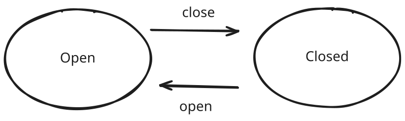
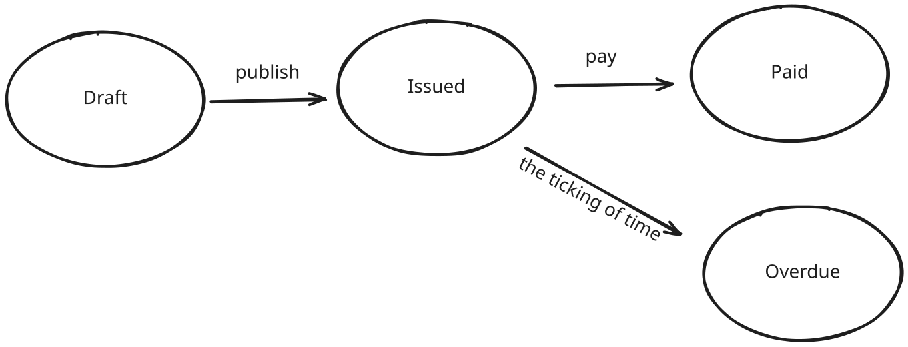
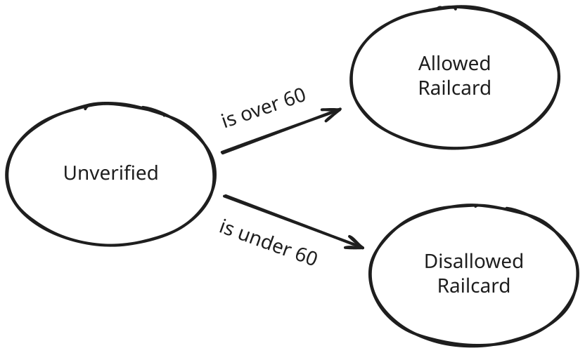

<tldr>
1. State machines are very useful ways of representing business logic and requirements
2. If your business logic is expressible in a logic, then it can be encoded in types, by the Curry-Howard isomorphism
3. Type-level state machines (aka typestate) are a very good way of proving correctness of business logic and requirements
</tldr>

The first few sections give an introduction to Curry-Howard and state machines, so feel free to skip if you're already familiar with them.

## Introduction

Formal verification (FV) has been gaining a lot of traction lately, mainly driven by the desire to add more correctness and confidence in the output of more hands-off agentic engineering practices. I think FV has a lot of value, but one of the risks with it is the risk of drift. At least when using tools like TLA+, for example, where the domain is formally expressed in a language that is not the language of implementation. The risk quickly becomes that the formally-verified spec "drifts" away from the actual coding implementation - in the same way that comments drift from implementation.

The other approach taken has been to write code in proof-assistant languages like Lean 4. This solves the drift risk because the code that is proven is the implementation code. Anthropic have [written quite a bit about their forays into Lean4 formally-verified code](https://www.anthropic.com/research/provable-inference).

But there is actually a very simple way of proving your code is correct without having to write formal specs or formal proofs. But first we need to understand two ideas: Curry-Howard & State Machines.

## Constructivism and Propositions as Types

The idea is based on the Curry-Howard isomorphism, or as Philip Wadler named his paper _Propositions as Types_. Every logical proposition corresponds to a type, and, as it turns out, programs - which are collections of types and functions - correspond to proofs.

For example, if the proposition `A` is true, then that is the same as constructing the type `A`. Likewise, if the proposition `B` is true, then that's the same as constructing the type `B`. And if we combine these together, then the proposition that `A & B` is true is the same as constructing the pair type of `(A, B)`. To give an example of this, suppose we have the proposition that _this wall is made of brick and is painted red_. That would correspond to a program in which we have a type containing brick and a type containing red, and then we construct the pair of `(Brick, Red)`.

// NOTE: is this right, or would we need the brick and red to be elevated to the type level?

What's really fascinating about the Curry-Howard isomorphism is that this applies to all logical connectives (i.e. logical `AND` is a pair, logical `OR` is a disjunct union, logical `if-then` is a function, etc). And because of this fact we can map back and forth between logic and programming. Now, relevant to this discussion is the subject of intuitionistic logic, which is a type of constructivist mathematics. we don't need to go into the details here, but the relevant point here is that in intuitionistic logic you have to _construct_ the proof you are trying to proof. What this means in practice is that you cannot say something like "it's raining or it's not raining", which would be true in classical logic. Instead, in intuitionistic logic, you have to construct/prove of one of the operands - i.e. proof that it is raining or proof that it is not raining. Only when you have a proof for it raining (or not) can you say that "it's raining or it's not raining" is true.

And because of the Curry-Howard isomorphism, this also applies to programming. All we need to do to prove a proposition is to construct it in the type system. And in fact, as Wadler notes,

> for each way to simplify a proof there is a corresponding way to evaluate a program

That is to say that the act of evaluating a program is equivalent to simplifying a proof. I've most definitely not done the idea justice, but I'm not attempting to here. For a more detailed look at the Curry-Howard isomorphism, definitely check out Wadler's paper.

## State Machines

The second idea that we need is going to be much more familiar to programmers, and it's the idea of a state machine. But to recap, a state machine is a system which has a finite number of states and transitions between those states. For example, a door might have the states of `Locked` and `Unlocked`, and it might have transitions between those two states of `lock the door` and `unlock the door`.

What's important about state machines is that although they are very simple they are sufficient to perform any computation (providing they have unbounded memory, which is when they become Turing machines. (With bounded memory they can describe simpler models of computation, such as regular languages (i.e. regex))).

## Typestate (aka. Type-Level State Machines)

Going back to the initial opening paragraphs on TLA+, thinking about software engineering and how a big part of the challenge is around turning requirements into formal specification, it seems to me that we can leverage Curry-Howard and state machines to take requirements and turn them into both executable code and a proof of that executable code. The first step is to turn our requirements into a state machine, and I think firstly that a large part of software can be represented as a state machine. Secondly, that requirements and business logic are usually just transitions between different states.

In order to leverage the Curry-Howard isomorphism, what we need to be doing is not just creating state machines, but creating state machines at the type-level. Once we create them at the type level, then we get our proof of correctness.

(There are a couple caveats that need to be made. The first is that there are different levels to which we can do this depending on what we are quantifying over (more on that later), and the second is that there is a minimum level of expressiveness that we need. So this is just not going to work in unsound languages like TypeScript and - for obvious reasons - dynamic languages like JS, Python, etc, because they cannot express very much.)

Let's look at a really simple example to illustrate how we can do this. Consider a door, which can be in two states - open or closed. You can't open an already open door, nor can you close a closed door. You can open a closed door and close an open door. So we have the following states and transitions between those states,



We can easily encode this in a type-system, as follows:

```rust
struct Open;

struct Closed;

impl Closed {
  fn open(self) -> Open;
}

impl Open {
  fn close(self) -> Closed;
}

fn main () {
  let door = Open;

  // this is fine
  door.close().open().close().open();

  // these won't compile
  door.open();
  door.close().close();
}
```

What's nice about using Rust here is that doors are resources and if you want to express _that_ fact in the type-system, then linear/affine types are a good option. So we can see in the `open` and `close` functions that we are taking ownership of the door. Also what is great to see here is that we literally cannot call `close` on an already closed door. `close` is only available when we have an `Open` door. 

Let's consider a case with 4 states. Suppose we are building an invoice system and we want to say an invoice can be either drafted, issued, paid, or overdue. The finite state machine is as follows: 



There are a couple different ways we can express this. As we say in the Rust example above, we can just use straight-forward product types and functions. There are (at least) two other approaches I think worth knowing about. The first is to use phantom types. This is especially useful when we want to have a single product type instead of multiple for each state of the machine - say because we want to share data between each of the states. Phantom types are little more awkward in Rust, so I'll use Haskell here,

```hs
data Draft
data Issued
data Paid
data Overdue

data Invoice state = Invoice {
  invoiceId :: InvoiceId
}

publish :: Invoice Draft -> Invoice Issued
pay :: Invoice Issued -> Invoice Paid
overdue :: Invoice Issued -> Invoice Paid
```

Here we create a `Invoice` type which has a `state` parameter which is unused. This is a phantom type. The way it helps us is each function can take an `Invoice state` and we don't have to create multiple types for each state.

Very similar to the Rust example we can see we have enforced the transitions at the type-level - it is impossible to call overdue on an already paid invoice, it is impossible to publish an already issued invoice, and the only way to pay an invoice is to have one issued first.

The third way of interest we can encode the state-machine into the types is to use a Haskell extension called `DataKinds`, 

```hs
{-# LANGUAGE DataKinds #-}

data Status = Draft | Issued | Paid | Overdue

data Invoice (s :: Status) = ...

publish :: Invoice 'Draft -> Invoice 'Issued
pay :: Invoice 'Issued -> Invoice 'Paid
overdue :: Invoice 'Issued -> Invoice 'Paid
```

This maintains the same API and benefits as the previous approach, but allows us to keep each state variant stored in the `Status` sum-type.

## The Axis of Dependent Types

What if we have requirements which are more difficult to encode in our Haskell/Rust type-systems? For example, we want to model a system where over 60s can get railcards. We need to verify their age and move the system into `Allowed` or `Disallowed` states based on that value. Can we still apply Curry-Howard to get proof-by-construction?



Well, yes we can. But we need something more powerful than standard-Haskell and standard-Rust. We are now approaching dependent types. To understand dependent types, I find it helps to see where they fit in relation to other aspects of our type-systems, because it can be easy to be overwhelmed by them.

Going back to the section on constructivism, we saw that we can take a very simple logic with a very few number of connectors and turn that into a type of algebraic data types and functions a mapping from propositional logic, namely the logic of propositions, to a relatively simple type system. But there are logics which quantify over propositions and in the land of programming languages this is all polymorphism is. For example, in Haskell the function,

```hs
reverse :: [a] -> [a]
```

is a function which takes a list of any kind of type and it returns another list of any kind of type. So here the function is polymorphic over that type and it can apply to anything that can go inside a list. And in fact, Haskell hides the quantifier, but implicitly this function is,

```hs
reverse :: forall a. [a] -> [a]
```

But we can also quantify over _values_ rather than over types. And when we do this we are expressing first-order logic. And this is what dependent types are doing for us.

| logic    | types |
| -------- | ------- |
| propositional logic | algebraic types |
| first-order logic   | dependent types |
| second-order logic  | polymorphism |
| linear logic  | linear types |
| S5 modal logic | spatially-distributed computing (e.g. ML5 lang) |
| ...  | ... |

Now, providing your business logic can be expressed in either propositional logic or second order logic, you can use a language like Haskell - and to varying degrees Rust. If you want to express first-order logic, then you need something stronger. You need either to enable many more extensions in Haskell to approximate dependent types, or you need a fully-fledged dependently typed language like Lean4, Idris, etc.

## Conclusion

With just these small examples, I hope you can see how easy it is to encode (business) logic into a type-system. All we've needed for the most part is straight-forward types and functions. I think it would be a very interesting project to work out how much business logic can be expressed as propositional logic and so only need algebraic types and functions to express in the type system. I suspect it's a very large amount.
