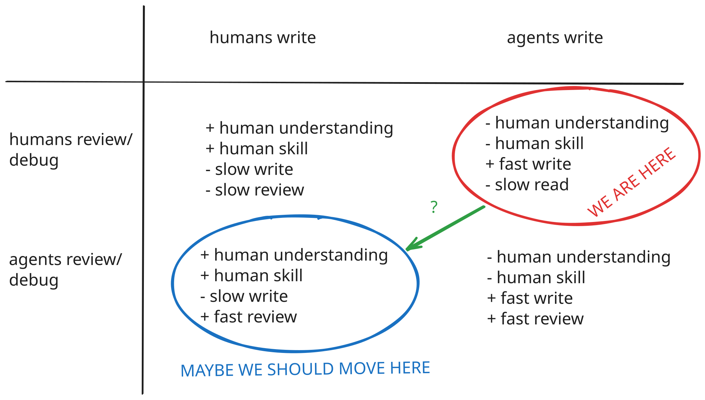

Software is solved, but review is not. At least that's the impression you'll get scrolling through the depths of software-engineering forums, in which software engineers are attempting to automate the review part of the SDLC. Human review is slow, and it is especially onerous for LLM-generated code. And in a world where LLMs can one-shot most problems, is there actually any need for human review and oversight, so the argument goes? So we seem to be moving to a world where agents write code and agents review code, if review happens at all.

I think we might have this all the wrong way around. The benefits of writing code are multi-faceted (see my [programming as discovery](https://chris.thecoffeecorner.dev/2026/10/08/programming-as-discovery.html) blog), but principle among them are human-orientated benefits which we lose when agents write code. Just to pick two examples: human understanding (of the domain and code) and human skills.

On understanding, I don't think it's contentious to say that understanding is a spectrum and the closer you work with some code, the more you understand it. On the other hand, the more removed you are from the code, the less (deeply) you can understand it, and so the less you can know if it correctly describes your domain. The argument that we can understand our code by just staying at a systems-level of thinking is to have our cake and eat it. (See Sean Geodecke's [You Can't Design Software You Don't Work On](https://www.seangoedecke.com/you-cant-design-software-you-dont-work-on/
)).

Universally-agreed is the fact that as we stop writing code, we start to lose our skills. However, I do see some engineers argue that the skill of programming doesn't matter anymore. Most of us don't learn to ride horses anymore, instead we learn how to drive cars. But seeing how LLMs are progressing, I don't think there will be an equivalent of learning to drive cars for engineers. It feels to me like we're on the fast-track path to cognitive decline.

I don't need to wax lyrical about the advantages of LLMs. They are extremely fast knowledge-retrieval systems and extremely good at pattern-matching. To me that sounds like they should be very good at reviewing existing code, debugging it, offering suggestions, etc.

So, to get the best of both worlds, instead of agents writing and humans reviewing, we should flip it and have humans writing and agents reviewing.

