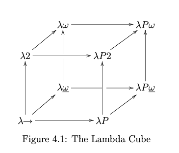
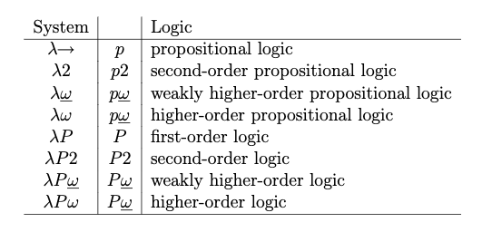

Something I see people get hung up on quite often is the relationship between types and tests. In this post, I'd like to explicitly draw out a hierarchy of types and tests.

Firstly, what does a test do? In essence, it takes a *system under test*, feeds it some input, and observes the output. If the output is as expected, the test passes; if not, it fails. This is the essence regardless of whether it's a unit test, integration test, end-to-end test, black-box test, white-box test, etc.

We can abstract this idea by saying a test takes a (pure or impure) function and checks the output, for some given input, is as expected. Unit tests generally take pure functions as their "system" and end-to-end tests take impure functions (i.e. systems with side-effects). And in a certain sense, the test is generating a "witness" for whatever claim is being tested.

Types, on the other hand, can feel much more inert. However, this couldn't be further from the truth. Types express logical propositions, and as such, when we create a function or value that inhabits a type, we are also providing a witness for that logical proposition. The test's witness is `assert(1, 1) => true` and the type's witness is `f :: Int -> Int; f n = n`.

So types and tests seem to be doing a very similar job. They both take a claim of sorts and provide a witness for that claim, where the witness in some sense proves the claim. However, there are two main differences: (a) types provide a witness at compile time whereas tests provide a witness at runtime, and (b) the level of quantification, where tests - generally speaking - only test one thing, whereas types are much more far-reaching in scope.

On the second point, suppose we have the function `f` with the type `A -> B` as saying *forall values in A, we can create B*. Once we create the function, we have thereby proven it (see my [Types, Logic, Business Requirements](https://chris.thecoffeecorner.dev/2026/11/03/types-logic-business-requirements.html) blog on how this constitutes "proof"). But if we write a test for `f` then our test at most can say *there is at least one instance of A from which we can create B*. The difference here is the difference between universal and existential quantification. Types give us universal constructive proofs, whereas tests give us existential ones.

Crossing the gap from existential tests to universal types is the case of property tests. Property tests assert that *forall inputs a given property holds of the system*. This is much closer to a type than your normal unit and integration test because it is now providing a witness to a universal quantification.

So far the hierarchy looks something like: `unit/integration tests < property tests < types`. But what's interesting is that types themselves exist in a hierarchy and within that hierarchy they correspond to different logics. 

The first rung up the ladder is a type-system corresponding to propositional logic. This is a type-system that supports algebraic data types (ADT) and let's us prove things about propositions. For example, the proposition *this user is verified and this user has an email address* can be expressed in propositional logic simply as `UserVerified & UserEmail` which corresponds to the ADT of a pair/product `(UserVerified, UserEmail)`[1]. 

Moving up from propositional logic, there are type-systems that correspond to different orders of logic (i.e. first-order, second-order) and different quantifications. Quantification is very interesting because we saw already that types quantify over all inhabitants - i.e. the type `Int` quantifies, or abstracts, over all integers. But we can also quantify over types themselves. Type-theory calls this polymorphism and languages like Java and Rust call it generics. So a function `forall a. a -> b` (or `fn<A, B>(a: A) -> B`) is quantifying over the types themselves and not just the values inhabiting those types. These types of functions are very hard to test via unit tests because the test must pick one particular concrete instance for `a` and `b` and then write one particular test for those concrete types. But in terms of coverage that barely scratches the surface. Property tests would be more helpful, but would still have to pick a concrete instance for the `a` and `b` types.

Aside from polymorphism we also have types which can depend on other types (called "type-operators"), and types which can depend on terms. An example of the former is Haskell's higher-kinded types and an example of the later is Idris' dependent types. Furthermore, we can combine each of these three properties - polymorphism, type-operators, dependent types - to form a cube, where each vertex of the cube corresponds to a particular logic. 

*See [my cube page here for an interactive lambda cube](/cube).*

The details of the cube and their logical correspondences don't matter for my purposes here, instead all I hope to have shown is (a) that even types exist in a hierarchy of sorts, and (b) we can think of types as being an abstraction or subsumption over tests. 

So if we plot the two out together, then we have a ladder of sorts starting from unit tests, to property tests, to the first vertex of the lambda cube which expresses propositional logic, and upwards building more and more expressive power whilst corresponding to more and more powerful logics. This tells us that tests and types are not two sides of the same coin but rather more of a continuation as they are both doing the same thing - providing a witness.

## Footnotes

[1] Languages like Rust use structs for product types.
